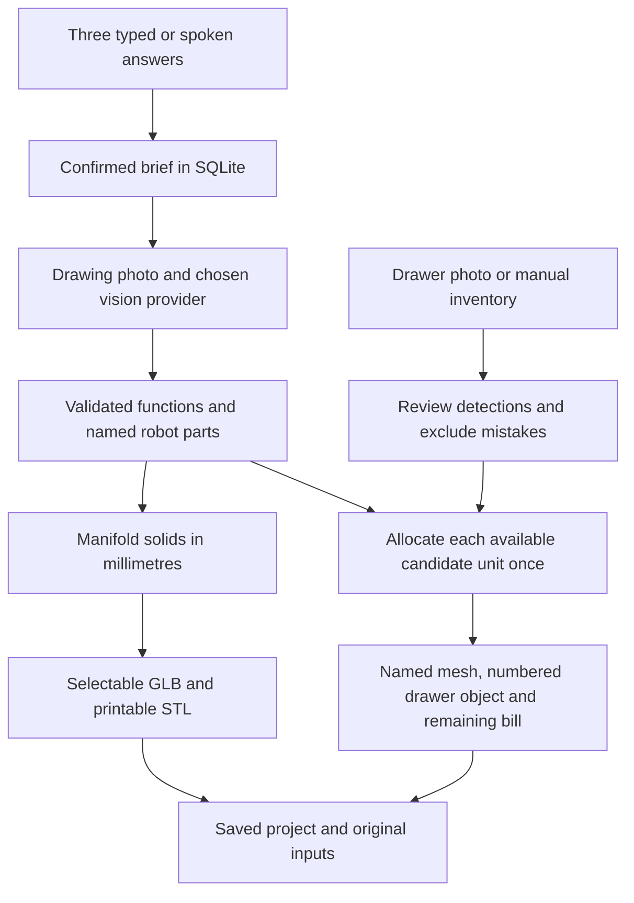

# Tejass’s engineering plan for I, Render

A judge should be able to point to a wheel on a drawing, find that wheel on the generated model and see exactly which object in the drawer might supply it. Tejass owns that path from the confirmed interview through saving and reopening the project. Zlata owns the prompts, product story and submission. Brian owns the physical Rendi, audio setup and venue fabrication.

## How the software works

| Stage | Implementation | What has to be true in the demo |
| --- | --- | --- |
| Interview | The browser asks for size, personality and job. Local Whisper can transcribe one answer at a time. The user edits the summary before `POST /api/brief`. | A correction changes the confirmed brief. A failed microphone recording still leaves a usable text field. |
| Sketch | `POST /api/sketch` accepts a photo or labelled example plus the brief ID. Photo recognition defaults to local Qwen. An explicit Gemini selection sends the photo to Google. The provider and prompt version form part of the cache key. | The server returns named parts, their dimensions, the source, the sketch photo and unresolved requested actions. A blank page receives an actionable error. A failed repair can retain a usable first result with its unresolved actions. |
| Geometry | Manifold constructs the solids. The GLB has named meshes, uses metres and points up along Y. The STL uses millimetres and points up along Z. | The judge can rotate, select by keyboard or pointer, and download the model. The workbench discloses estimated depth and multi-piece exports. A slicer preview or a caliper check supplies the next piece of evidence. |
| Drawer | `POST /api/junk` returns the image, ordered detections, conditions and candidate components. A manual inventory works offline. | A mistaken identification can be excluded and restored. The photo box and row keep the same index. Hazardous objects stay excluded. |
| Matching | `POST /api/plan` joins the brief, sketch, inventory and excluded indices. The backend returns one allocation per required unit, drawer matches, sourcing gaps and assembly steps. | Selecting a named wheel highlights the furnishing object and its bill row. A shared controller or supply is counted once. A component without a modelled mounting point is labelled at the function level. |
| Notebook | `POST /api/projects` saves a plan idempotently. `GET /api/projects/{id}` restores the sketch, drawer, mesh files, plan, exclusions and memory entry. | Reopening or refreshing preserves the result. Seeded examples are labelled. The saved outcome is “planned.” |

## What to do at the venue

| Toronto time | Owner | Deliverable or decision |
| --- | --- | --- |
| Saturday, by 2 p.m. | Tejass and Zlata | Run three distinct real paper sketches and a five-object drawer photographed from different angles and lighting. Record the actual counts, one error and its recovery. Target at least four correct identities per photo. Keep participant photos in the local notebook unless their owners approve sharing. |
| Saturday, 3–7 p.m. print window | Brian | Confirm the printer and material in room 2247. Try the half-hour wheel, measure the donor shaft and dry-fit it. Prioritize the separate Rendi enclosure according to the queue. Record the actual outcome. |
| Saturday, before 6 p.m. | Tejass | Rehearse with Mac audio at one metre. Aim for a confirmed brief in under a minute and a complete run under three. If an event Gemini key is available, spend up to 45 minutes comparing one uncached team sketch and drawer. Record the actual model and source only after a successful run. |
| Saturday, 6–7 p.m. | Zlata, then Tejass | Have Zlata perform one independent timed run. Fix blockers from her run, then freeze the feature set. |
| Saturday, by 11 p.m. | Zlata and Tejass | Freeze the demo build, verify the saved fallback and recording on the presentation Mac, and prepare one Devpost draft for the team. |
| Sunday, by 8:30 a.m. | Zlata | Record the human-operated demo if available, confirm the three team members and earned tracks, and check the final submission receipt. Coding and Devpost close at 9 a.m. Be at the assigned table by 11:30. |

Use the saved Snack Scout project if live recognition stalls. Announce when the team switches to a reference build. Claim physical fit, operation and sponsor integrations only when the team has demonstrated them. [Live demo script](DEMO.md) · [Fabrication handoff](hardware/slicing/README.md) · [Submission draft](SUBMISSION.md) · [Organizer rules](https://hack-western-13.devpost.com/rules)
