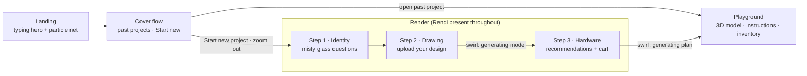

# I,Render — New design reference (v1)

What the redesigned app does, screen by screen, and how each function maps onto the code that already works. Status: **v1 — visual system implemented (Liquid Cobalt); the larger flow changes (§1, §3–5) are still pending the open questions in §9.** The original app is documented in [../original/REFERENCE.md](../original/REFERENCE.md).

Jump to: [Journey](#1-journey) · [Design system](#2-design-system) · [Screens](#3-screens-and-their-functions) · [Rendi](#4-rendi-the-agent) · [Generation moments](#5-generation-moments-the-swirl) · [Feature mapping](#6-feature-mapping-old--new) · [Motion & effects rules](#7-motion-effects-and-performance-rules) · [Accessibility](#8-accessibility) · [Open questions](#9-open-questions)

---

## 1. Journey

| # | Screen | One job | Primary action |
| --- | --- | --- | --- |
| 0 | Landing | Set the mood; say what I, Render is | Enter (click/scroll/key) |
| 1 | Cover flow | Pick a past project or start a new one | **Start new project** |
| 2 | Render · Identity | Capture who the robot is | Continue (per question) |
| 3 | Render · Drawing | Get the user's sketch | **Generate** |
| 4 | Render · Hardware | Choose parts | **Build it** |
| 5 | Playground | Build: see the model, follow steps, track parts | Tick parts / next step |

---

## 2. Design system

**Source of truth:** the brand board `I,Render — Brand & UI.html` (repo root): brand sheet, grain poster, app icon + glass dock, mobile onboarding, mascot expressions, studio dashboard. Implemented in [frontend/style.css](../../frontend/style.css). Exact values are in [tokens.md](tokens.md).

> The earlier indigo/gold palette (Space Indigo, Vintage Grape, Golden Pollen, Dark Cyan, Blue Slate) and Petrona/Karla type are **superseded** by this brand.

### Palette — Liquid Cobalt
| Token | Name | Hex | Role |
| --- | --- | --- | --- |
| `--midnight` | Midnight | `#03195B` | Dark hero surfaces (hero, Rendi, 3D stage, score, cover flow, busy pill) |
| `--cobalt` | Cobalt | `#0B2CB1` | Pressed/hover primary, active nav text, mascot eyes |
| `--signal` | Signal | `#1951FC` | Primary action, links, italic kickers, focus ring, glow |
| `--sky` | Sky | `#3781FC` | Gradients, detection boxes, accents (decoration only, not body text) |
| `--frost` | Frost | `#EAF0FF` | Selected pills, active nav, soft panels |
| `--ink` | Ink | `#0A0F1F` | Headlines, body on light |

App ground `#F2F4FA` with white cards (radius 28). Dark panels = Midnight + Signal radial glow + SVG grain (overlay, 30%).

**Contrast:** white on Signal 5.8 ✅ · white on Cobalt 10.5 ✅ · Signal on white 5.8 ✅ · `#4A5578` secondary text on ground 6.7 ✅ · pale `#BFD6FF` on Midnight 11.0 ✅ · Sky on Midnight 4.4 (large text or decoration only) · white on Sky 3.7 ❌ for small text.

### Typography
| Role | Face | Use |
| --- | --- | --- |
| Headlines | **Space Grotesk** 700, tight tracking (−0.045 to −0.06em) | h1–h3, wordmark, cover cards, numbers |
| The twist | **Instrument Serif** *italic* 400 | Kickers above headlines ("drop an idea,", "good to see you,", "Project brief · 1 of 3"), Rendi's status, descriptions |
| Everything you read | **Inter** 400–600 | Body, labels, buttons, inputs |

Three families, bundled locally with `@fontsource` (offline-safe at the fair).

### Shapes, glass and motion
- Radius: 14 controls · 22 small cards · 28 cards · 32 hero panels · pills 999.
- Buttons are pills: **Signal** primary, white outline secondary. On dark: **white** primary with Midnight text, **glass** secondary.
- Glass: `rgba(255,255,255,.12–.16)` + `backdrop-filter: blur(20px)` + 1px white 30–45% border + inner top highlight. Used for cover-flow centre card, viewer controls and secondary buttons on dark.
- Hover steps up 1px, press sinks and scales .985; cards lift 2–3px.

### Rendi — "the drop"
Brand drop SVG (radial white→`#7FA9FF` fill, soft white glow, shine). States map to the brand's expressions:
| App state | Expression |
| --- | --- |
| idle | Idle: open eyes, slow float, blink |
| listening | glow brightens, cheeks, breathing |
| thinking | **Rendering**: eyes shut arcs + twinkling sparkles |
| speaking | small mouth pulses |
| *(future)* success | **Delighted**: ^ ^ eyes + cheeks |

## 3. Screens and their functions

### 0 · Landing (dark) — ✅ built
Implemented in [frontend/landing.js](../../frontend/landing.js) (motion) and `landing()` in [frontend/src.js](../../frontend/src.js). Shown on every fresh load except saved-project links. **Start rendering** / **Skip to workshop** → Cover flow; **Open notebook** → Notebook.

Copy as built (change in `landingWords` / `landingLines`):
- Typed loop: **"I,Render"** (hold 1.6 s) → delete → **"what’s creative?"** (hold 2.4 s) → repeat.
- Rotating line, every 3.2 s: *Sketch it on paper.* · *Raid your junk drawer.* · *Watch Rendi render it in 3D.* · *Build it with your own hands.*
- Network: 28–110 ASCII glyphs (`.:+*#=~/\<>01{}[]`) linked within 132 px; the pointer pushes glyphs away within 150 px and draws white lines to nearby glyphs. Glass panel = white 8 % + 14 px blur.
- **Pause motion** button stops typing, rotation, particles and caret. Reduced motion: static "I,Render", first line, one still frame, no pause button. Touch: no pointer effect.

| Function | Behaviour | Notes |
| --- | --- | --- |
| Typing headline | Types **"I, Render"**, pauses, deletes, retypes **"what's creative?"** | Respect reduced motion: show the final text, no typing |
| Rotating line | Under the headline, a phrase cycles periodically | Copy TBD (Q3). Needs a pause control if it runs past 5 s |
| Particle network | Thin, glass-like ASCII-character nodes joined by Signal/Sky lines; nodes drift and react to the pointer (attract or repel within a radius) | Canvas 2D; 30 fps cap; pixel ratio ≤ 1.5; off on touch; still frame under reduced motion; pause when the tab is hidden |
| Enter | Button / Enter key / scroll → Cover flow | |
| Global | Voice on/off, voice output | Carried over from the header |

### 1 · Cover flow (project gallery)
| Function | Behaviour | Source |
| --- | --- | --- |
| Carousel | 3D cover-flow cards; centre card faces forward, neighbours angled and dimmed | New |
| Scroll / drag / arrows | Wheel, trackpad, drag, ← → keys, click a side card to centre it | New |
| Start new project card | Lands centred on load; selecting it plays a **zoom-out** transition into Render · Step 1 | Replaces **Start a build** |
| Past project cards | Saved projects + seeded examples, labelled. Thumbnail = model render or sketch | `GET /api/memory/search`, local saved index, `GET /api/projects/{id}` |
| Open past project | Goes to its Playground | Replaces notebook links / `#project/<id>` |
| Search / filter | *(optional)* filter cards by part or action | Replaces Notebook **Find a memory** |
| Starter robots | Wheelbot / Armbot / Blobbot as cards that prefill a new project? | Q7 |

### 2 · Render · Step 1 — Identity ("mystical fog") — ✅ built (same three questions)
Implemented in `interview()` / `confirmBrief()` in [frontend/src.js](../../frontend/src.js); styles under "Render · Step 1" in [frontend/style.css](../../frontend/style.css).
- A midnight stage with five slow-drifting fog banks (CSS, clock-synced so re-renders never jump) and grain. Rendi floats beside the glass card (above it on phones).
- One question per glass card: progress orbs, *Identity · N of 3* kicker, and the question **rises out of the blur** only when the question changes (not on pill taps).
- Inputs and pills are glass on dark; a selected pill glows white. Dictation and memory hints carry over. The last button reads **Reveal my robot**.
- **Reveal** (confirm): *the mist clears…*, an editable big name, glass trait tiles (Scale, Vibe, Adventure) with edit pencils, the memory note, then **Confirm brief**.
- Reduced motion: still fog, no rise.
- Still open (Q8): extra "identity" questions beyond these three.
| Function | Behaviour | Source |
| --- | --- | --- |
| One question at a time | Each question rises out of animated fog inside a glass panel; the answer shapes the next | Replaces the 3-question interview |
| Questions | Size/scale, vibe (1–3 words + suggestions), adventure, what it does (9 functions), name. More "identity" questions TBD (Q8) | `POST /api/brief` (ProjectBrief) |
| User-prompted | The user can type or speak each answer | Dictation (`/api/transcribe`) |
| Reveal | After the last answer, a "reveal" of the robot's identity card (name, vibe, functions) that the user can edit | Replaces **Confirm brief** |
| Memory hint | Rendi notes a similar past project | `GET /api/memory/search` |

### 3 · Render · Step 2 — Drawing
| Function | Behaviour | Source |
| --- | --- | --- |
| Prompt | Headline "Be clear, be creative, be you." | New copy |
| Upload | Drag-drop / file picker (JPG/PNG/WebP/HEIC ≤ 10 MB) with preview | `uploadBox` |
| Camera | Take a photo of the drawing | `cameraTools` |
| Examples | Use a starter sketch instead | Example templates |
| Generate | Triggers the **swirl** (§5) while the model is generated | `POST /api/sketch` |
| Provider | On this Mac / Gemini choice, labelled before sending | See Q10 |

### 4 · Render · Step 3 — Hardware
| Function | Behaviour | Source |
| --- | --- | --- |
| Recommendations | Cards for what the project could involve: components per function (motors, LEDs, sensors…) and variations ("make it walk instead?") | `data/function_requirements.json`, plan `to_source`, `alternatives` |
| Add to cart | Each component has quantity + add/remove; the cart is visible as a drawer or side panel | **New**. See Q5 |
| Drawer salvage | Scan or count your junk drawer so items you already own are marked "have it" | `POST /api/junk`, manual inventory. See Q4 |
| Build it | Triggers the **swirl** while the plan is written | `POST /api/plan` |

### 5 · Playground — ✅ layout built
Replaces the old Build plan screen (`result()` in [frontend/src.js](../../frontend/src.js)); the stepper's last step is now **Build**. Built:
- **Left:** 3D model, pinned while the right column scrolls, with the part chips and inspector under it.
- **Top right, Assemble:** one step at a time (Back / Next step / step dots). Parts named in the step become chips, glow blue in 3D, and the rest of the model fades (`viewer.focus(ids)`, matched by part label in the step text).
- **Bottom right, Inventory:** every drawer donor and to-source part as a tick-off row with its source; expand for how to salvage, tools, substitutions and alternatives. "N of M gathered" plus a progress bar; all ticked shows *Everything's ready.*
- Step and ticks persist per project in `localStorage` (`irender-playground-<id>`) and carry over when the build is saved.
- Header: project name, a small Rendi badge, Save / STL / GLB / Start a new idea. Below the workspace: safety notes (above the grid), drawer photo, sketch, assumptions, Rendi remembers.
- Not built yet: **modifying** the model (Q6), and the cart from Step 3 (Q5).

Layout: **left** = 3D model (large) · **top right** = assembly instructions · **bottom right** = inventory.

| Function | Behaviour | Source |
| --- | --- | --- |
| 3D model | Orbit, zoom, fit, select part, highlight; **modify** (TBD Q6) | `viewer.js`, GLB |
| Part inspector | Selected part's dimensions + function (popover on the model) | `selectPart` |
| Instructions | Step-by-step cards with next/prev; the current step highlights its parts in 3D | Plan `steps` |
| Inventory checklist | Every part with qty, source (drawer donor / cart / have), tick-off checkboxes, progress count | Plan `from_your_drawer`, `to_source` |
| Safety notes | Pinned, non-dismissable where relevant | Plan `safety_notes`, held items |
| Downloads | STL / GLB | `stl_url`, `glb_url` |
| Save | Save to Rendi's memory → appears in Cover flow | `POST /api/projects` |
| Peak/end | Finishing all steps → a celebration moment + "saved" confirmation (peak-end rule) | New |

---

## 4. Rendi (the agent)
| Function | Behaviour |
| --- | --- |
| Form | A **3D blob** (three.js, metaball or noise-displaced sphere) in the brand's drop style (white→`#7FA9FF` glass), evolving the SVG drop now in use |
| Movement | Drifts around the screen to sit near whatever it's talking about; never covers the primary action or text being read |
| States | idle (slow wobble, blink) · listening (breathing, Signal glow) · thinking (swirl inside) · speaking (pulses with voice) · observing (leans toward the element it's commenting on) |
| Observations | Short remarks tied to user actions ("That arm looks long for a 10 cm robot, want me to shorten it?"). **Source TBD (Q9)**: scripted rules vs an LLM |
| Voice | Speaks its lines when Voice is on (browser / ElevenLabs), as today |
| Controls | Mute, hide/minimise, and "ask Rendi" if it becomes conversational |
| Persistence | Present from Render · Step 1 through the Playground |

Conversational-UX rules: one clear thing per line; say what response is expected; confirm explicitly only for consequential actions (e.g. sending a photo off-device).

---

## 5. Generation moments (the swirl) — ✅ built
Implemented in [frontend/swirl.js](../../frontend/swirl.js), triggered from `job()` in [frontend/src.js](../../frontend/src.js) for four labels: reading a sketch, building a starter example, identifying drawer items, writing the plan (`swirlKinds`). Other waits keep the small busy pill.
- Opens immediately; the page underneath is `inert`. Three spiral arms of particles stream Sky → white into Rendi's **Rendering** face (eyes shut, sparkles).
- Status in Space Grotesk; a serif stage line advances every 2.2 s and holds on the last stage; after 10 s a "still working" note explains the wait.
- Success: stays at least 0.9 s, says *Rendered.*, the vortex collapses inward, Rendi flashes, the overlay fades onto the new screen, and focus moves to its heading. Failure: fades in 0.2 s and the error shows in the notice bar.
- Reduced motion: no canvas, a still glowing ring with the same text. No cancel yet: the backend calls can't be aborted.

| Function | Behaviour |
| --- | --- |
| Trigger | Step 2 → model generation; Step 3 → plan generation |
| Visual | Particles / the user's drawing spiral into a vortex (Sky → white, like the grain poster's ring), Rendi at the centre in "thinking" |
| Feedback | Within 100 ms acknowledge; at 1–10 s show stage text ("Reading your lines…", "Shaping parts…"); over 10 s show progress or an estimate plus a cancel/back option (loading-states, Doherty) |
| Result | The swirl resolves *into* the result (the model materialises), not a cut |
| Failure | The swirl settles, with a plain error, retry, and the local fallback when Gemini fails |
| Reduced motion | A static spinner and the stage text |

---

## 6. Feature mapping (old → new)
Every current feature needs a home or an explicit decision to drop.

| Current feature | New home | Status |
| --- | --- | --- |
| Home hero + starter robots | Landing + Cover flow | mapped |
| Workshop / Notebook tabs | Cover flow is the hub; global nav TBD | **Q2** |
| 5-step progress bar | Render step indicator (3 steps) | mapped |
| Interview + confirm | Render Step 1 | mapped |
| Dictation, voice output | Step 1 + Rendi | mapped |
| Sketch upload / camera / provider / retry / examples | Render Step 2 | mapped |
| Model viewer + inspector + downloads | Playground (left) | mapped; is there a model preview before Step 3? **Q11** |
| Low-confidence / still-to-design warnings | Playground + Rendi observations | mapped |
| Drawer scan, manual counters, detection boxes, exclude/restore, safety holds | Step 3? Playground inventory? | **Q4** |
| Build plan: score, donors, to-source, alternatives | Step 3 (recommendations/cart) + Playground inventory | mapped |
| Build steps | Playground (top right) | mapped |
| Safety notes | Playground | mapped |
| Save to memory / notebook search / saved list / deep link | Playground save + Cover flow | mapped |
| Reset build | ? | **Q2** |

---

## 7. Motion, effects and performance rules
Adapted from **taste-skill** (motion, perf, effects) and **designer-skills** (dark mode, loading states, Doherty threshold, peak-end, conversational UX). Kept: the rules that fit an interactive app. Skipped: marketing-site rules (photography, section-per-screen, copy dealing).

- **Durations:** hover 150 ms in / 120 ms out, press 90 ms, panel 200 ms, travel 240 ms, view transitions < 400 ms. One UI ease `cubic-bezier(.2,.8,.2,1)`; entrances `cubic-bezier(.22,1,.36,1)`.
- **Buttons** step up 1 px on hover and press down on click. Linked cards lift 2 px. **No tilt** on cards (except the cover flow itself).
- **One pointer effect per screen** (landing: particle network; no custom cursor; no magnetic buttons).
- **No scroll-jacking, no fade-in on every section**, no parallax on text.
- **Anything moving > 5 s** (rotating line, particles, Rendi idle) has a way to pause; under `prefers-reduced-motion` everything rests and nothing stays hidden.
- **WebGL:** ≤ 4 live contexts (Rendi blob + 3D model + swirl count). Particles/noise at half resolution and ≤ 30 fps, pixel ratio ≤ 1.5. Each effect keeps a still fallback.
- **Budgets:** JS ≤ 450 KiB parsed (three.js is the main cost), fonts ≤ 4 files, CLS < 0.1, animate only transform and opacity.
- **Glass on text:** blur behind panels is fine, but body text sits on a ≥ 4.5:1 effective background. Never put blend modes on text.

## 8. Accessibility
- Contrast as in §2. Focus ring is a 3px Signal outline, offset 3px, on every control.
- Keyboard: cover flow ← →, Enter selects; Render steps are forms; the 3D viewer keeps its arrow/+/−/Home keys.
- Live regions for Rendi's lines and generation status; focus moves to each step's heading.
- Tap targets ≥ 44px. Keep the skip link. Respect `prefers-reduced-motion`.
- Don't rely on colour alone (ticked inventory = check icon + strikethrough, not just colour).

## 9. Open questions
Tracked here and in the chat discussion. Answers become decisions in this doc.

1. **Theme:** the brand mixes a light app ground with Midnight hero panels (as built). Should the landing go fully dark?
2. **Navigation:** after the landing, is the Cover flow the "home"? Is there a persistent top bar (logo, voice, back to gallery)? Can users jump back between Render steps?
3. **Landing copy:** built with placeholder copy (see §3 · 0). Replace the four rotating lines? Keep the loop?
4. **Junk-drawer salvage:** the current core feature (scan drawer → match donor parts) has no clear slot. Fold it into Step 3 ("check what you already have") or the Playground inventory, or drop it?
5. **Shopping cart:** list-only, or links to real stores (which)? Prices? Export or share the list? No real checkout?
6. **"Modify" the 3D model:** select and recolour parts? Resize parts (needs regenerating)? Add or remove parts? Drag positions?
7. **Starter robots:** keep Wheelbot/Armbot/Blobbot as cover-flow cards, as Step 2 examples, or both?
8. **Step 1 questions:** beyond size / vibe / adventure / functions / name, what are the "project identity" questions (colour, personality, origin story, who it's for)? How many?
9. **Rendi's observations:** scripted rule-based lines (offline, safe) or LLM-generated (which model, online)?
10. **Gemini:** the README notes Gemini's terms exclude apps likely used by under-18s, and this is a youth-outreach demo. Should the swirl be provider-agnostic, with local Qwen as the default?
11. **Model preview:** after Step 2's swirl, does the user see the 3D model before Step 3, or only in the Playground?
12. **Fonts:** ~~resolved~~ Space Grotesk, Instrument Serif and Inter are bundled locally.
13. **Stack:** stay vanilla JS + Vite + three.js (current), or move to a framework (React) for the bigger UI?
14. **Deadline / priority:** what must be done for the next demo, and in what order?
