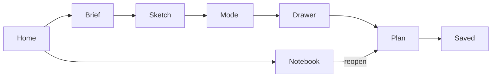

# User flow

## Current journey (baseline)
`home → interview (×3) → confirm → sketch → model → drawer → inventory → result → save` · side path: `notebook`

## Target journey
_Sketch the new flow here (Mermaid is fine)._

## Navigation questions
- Can users jump back to any completed step? What happens to later steps?
- Where does Rendi live on each step (persistent dock vs. per-screen)?
- Where do the example projects live for people without a sketch?
- What's the empty, loading and error state of each step?
