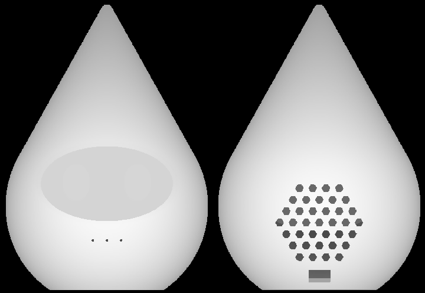

# Rendi droplet shell

## Brian’s current print

Brian is printing a roughly 140 mm tall shell with four pin sockets. Keep his **01 front** and **02 back** together. Choose **03** for raised eyes or **04** for two LEDs. Both plates enter from the outside and rest on the front lip. Test one **06 loose pin** before fitting all four. The **05 standard pin** has slight interference in the digital model.

Let a clean print finish. With the front seam-down, check the slicer preview around 19 mm above the bed. The oval faceplate ledge starts there with no overlap with the model layer beneath it. Bambu Studio flagged that front when supports were off. If it has already printed, inspect the ledge and try the plate. If the seat has sagged enough to prevent insertion, only the front needs a supported reprint. On a P1S with a 0.4 mm nozzle and Generic PLA, Bambu Studio estimated about two hours and 49.5 g for that front, or ten minutes and 0.87 g for four spare loose pins. The rear cable opening measures about 9.9 × 3.6 mm straight through. Dry-fit the actual plug before closing. For rehearsal, the mic can sit at the front crescent and the speaker behind the rear grille. Verify audibility at one metre.

## Ring-joined fallback in this repo

The files below form a separate 120 mm enclosure with a join ring and its own faceplate. Use its files together if the team needs a replacement enclosure.

**The four pieces are sliced for a Bambu P1S.** The plate estimate is **2 h 49 min and 76.89 g PLA**. Dimensions and clearances below come from the digital mesh. Physical fit awaits the first print. [Open the Bambu Studio project](slicing/Rendi-P1S.3mf) · [Printer settings and queue instructions](slicing/README.md)



## Files

| File | What | Bed orientation in the STL | Print size (X × Y × Z) |
|---|---|---|---|
| `stl/rendi_front_half.stl` | Front half: face opening, 3 mic holes | Seam face down | 85 × 120 × 41.6 mm |
| `stl/rendi_back_half.stl` | Back half: speaker grille, cable slot | Seam face down | 85 × 120 × 42.5 mm |
| `stl/rendi_faceplate.stl` | Swappable eye insert (recessed flat panel, raised eyes) | Panel back down, open side up | 60 × 38 × 16.7 mm |
| `stl/rendi_join_ring.stl` | Friction ring that holds the halves together | Flat | 80 × 103 × 6 mm |
| `rendi_shell.py` | Parametric source. Edit the `PARAMETERS` block, re-run | | |
| `verify.py` / `verification.txt` | Mesh and clearance checks, and the last output | | |
| `preview.py` / `preview.png` | Quick assembled picture | | |

The STLs are already rotated for printing. Do not re-orient them in the slicer.

Regenerate (about 10 s, needs only Python 3 + numpy):

```
python3 rendi_shell.py && python3 verify.py > verification.txt && python3 preview.py
```

The four STLs total about 82 MiB. The 3MF includes the meshes, saved orientations and printer settings.

## How it goes together

1. Glue the join ring into the **back** half so 3 mm sticks out past the seam. It then acts as the spec's "3 mm friction lip on the back half".
2. Push the faceplate into the oval opening **from the inside** of the front half. The opening is tapered 7° per side, so the insert wedges and cannot come out the front. A dab of hot glue or tape behind it stops it falling inward.
3. Fit electronics, run the cable out of the slot at the back of the base, press the front half onto the ring.

## Spec vs. what was built

| Spec (03a §6) | Built | Note |
|---|---|---|
| Height 120 mm | 120.0 mm | |
| Max Ø 85 mm, bulb 35–40 mm up | 85.0 mm at 35 mm | |
| Wall 2.4 mm | 2.4 mm wall and floor | |
| Vertical front/back split | Yes, flat seam at the centre plane | |
| 3 mm friction lip on back half | **Separate ring**, 3 mm into each half | Deviation, see below |
| 60 × 35 mm oval opening | 59.6 × 35.0 mm at the front rim | Tapered, wider inside |
| Separate faceplate insert | Yes | Flat panel is recessed, not flush with the curve |
| 3× Ø2 mm mic holes below the face | Yes, 6 mm apart, 6 mm below the opening | |
| Ø40 mm hex grille, back-bottom | 37 hex holes, 4 mm across flats, centred 28 mm up | |
| 10 × 6 mm cable slot, base, back | Yes, just above the 2.4 mm floor | |
| Flat 50 mm Ø base | **48.2 mm** | Follows from the 85 mm bulb at 35 mm. Lower `BULB_Z` to 34.4 for 50 mm |

Deviations and why:

- **Join ring is a fourth part, not a lip moulded on the back half.** A lip that sticks out past the seam would lift the back half's seam face 3 mm off the bed and need supports along the whole visible seam. As a separate ring, both halves print with their full wall flat on the bed.
- **Faceplate is a recessed flat panel.** The shell curves about 12 mm across the 60 mm opening, so a flush insert would be a dome that needs supports. The flat panel prints clean, takes paint or stickers, and suits flat LED or display parts. Eyes are 0.6 mm raised ovals; edit `EYES` to change them.
- **No magnet bosses.** The spec offered a lip *or* magnets; only the lip route is modelled.

## Checked in CAD (`verification.txt`, 36 PASS lines and no FAIL)

- Each STL read back from disk: watertight, consistent winding, one shell, no collapsed triangles, positive volume.
- The script prints each part’s genus without asserting it. Read by hand, the printed values match the design’s through-holes: front 4 (opening + 3 mics), back 38 (37 grille + cable slot), ring 1, faceplate 0.
- Assembled size 85.0 × 84.1 × 120.0 mm (the front is 0.4 mm short of 85 because the opening removes the foremost point).
- Seam faces touch with no overlap. Ring to wall gap is 0.19 mm measured against a 0.20 mm design value. Faceplate to opening gap is 0.06 mm with no overlap.
- Every part sits on z = 0 with a real flat bed face (front 487 mm², back 552 mm²) and fits a 180 mm bed.
- Solid volumes: front 24.2 cm³, back 27.3 cm³, ring 2.7 cm³, faceplate 3.3 cm³. Roughly 70 g of PLA at 100% density, less at 10–15% infill.

## At the printer

- **Supports.** The spec says "no supports needed". The mesh says otherwise for the crown of each half: the back has about 12 cm² of surface within 30° of horizontal, the front about 7 cm² (the face opening removes the rest). Without supports the inside of the crown will droop. Recommended: supports from the build plate only, threshold about 30°. The faceplate and ring need none.
- **Ring fit (0.20 mm gap per side).** Not printed. If loose, raise `RING_T` or lower `RING_CLEAR`; if it will not go in, raise `RING_CLEAR`. Dry-fit before gluing.
- **Faceplate fit (0.10 mm undersize per side).** Because of the 7° taper, each 0.1 mm of print error moves the insert about 0.8 mm in or out. The rim is designed to sit 0.6 mm below the shell surface to absorb this. Tune `FACE_FIT`.
- **Friction is the only thing holding the halves.** No snap or screw. Bring tape or a rubber band as backup for the demo.
- **Cable slot is 10 × 6 mm per spec.** A bare cable or a USB-C plug fits; many USB-A plugs and thick overmoulds will not pass. Widen `CABLE_W` / `CABLE_H` if needed.
- **Speaker mounting.** There is a grille but no mount. A flat 40 mm speaker leaves about a 5 mm gap at its rim against the curved wall; plan on hot glue or foam.
- **Component fit.** No electronics were modelled, for any hardware tier.
- **Print time.** Two local slices with the saved P1S profile agreed on 2 h 49 min 15 s, including preparation. Allow extra time for the queue, cooldown and removal.
- **Stability.** The 48 mm flat base is not tip-tested with a speaker and cable inside.
